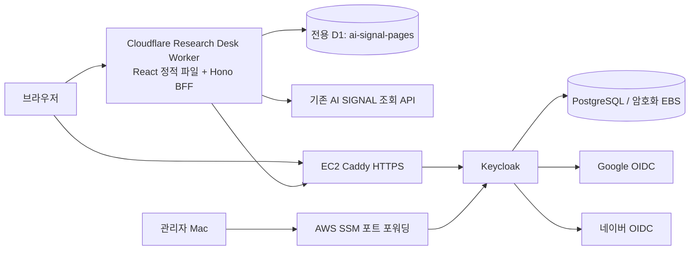

# 구성과 인증 아키텍처

## 최종 배치

앱과 IaC의 저장소는 분리한다. 앱은 기존 AI-News-Crawler 디렉터리형 모노레포에 있고 별도 Worker/D1로 배포한다. 기존 뉴스 API와 수집기의 DB·스케줄을 바꾸지 않는다. Keycloak IaC는 terraform-keyclock 저장소에 둔다. 저장소 철자는 사용자 지정대로 keyclock, 제품명은 Keycloak이다.

## OIDC와 세션

1. `/auth/login`이 state/nonce/PKCE verifier를 생성하고, state 해시와 verifier·nonce를 D1에 5분 보관한다. 브라우저에도 HttpOnly 흐름 쿠키를 설정한다.
2. 브라우저가 Keycloak으로 이동하고, 필요하면 Google/네이버로 이동한다.
3. 소셜 로그인 콜백은 Keycloak의 `/realms/ai-signal/broker/{google|naver}/endpoint`다.
4. Keycloak이 앱 `/auth/callback`으로 code/state를 전달한다.
5. Worker는 state 쿠키 일치와 유효기간을 검사하고 DELETE RETURNING으로 흐름을 일회 소비한다. client secret과 PKCE verifier로 코드를 교환한다.
6. jose로 Keycloak RS256 서명, issuer, audience, exp/iat, nonce, azp를 확인한다. Keycloak 클라이언트 역할 매퍼가 넣은 `page_roles`만 사용한다.
7. 임의 세션 ID를 쿠키로 주고, ID 해시·사용자 sub·이름·역할·만료시각을 D1에 저장한다. ID/access/refresh token은 저장하지 않는다.
8. 세션은 ID token 만료와 5분 중 짧은 값까지 유지한다. 역할 변경/사용자 비활성화가 기존 앱 세션에 반영되는 데 최대 5분 걸린다. 즉시 차단하려면 해당 sub의 sessions를 D1에서 삭제한다.

브라우저에는 OAuth 토큰이나 client secret을 전달하지 않는다. HTTPS에서는 Secure·HttpOnly·SameSite=Lax 쿠키를 사용한다. 모든 변경 API는 Origin과 사용자 정의 헤더를 확인한다. 앱 로그아웃은 D1 세션만 폐기하며 Keycloak·Google·네이버의 SSO 로그아웃은 수행하지 않는다.

## 인가

| 역할 | 공유 페이지 조회 | 자기 초안 조회 | 작성/자기 페이지 수정 | 다른 사용자 초안/수정 | 삭제 |
|---|---|---|---|---|---|
| 미로그인 / 역할 없음 | 불가 | 불가 | 불가 | 불가 | 불가 |
| viewer | 가능 | 가능 | 불가 | 불가 | 불가 |
| editor | 가능 | 가능 | 가능 | 불가 | 불가 |
| admin | 가능 | 가능 | 가능 | 가능 | 가능 |

소셜 로그인 성공을 admin 승인으로 취급하지 않는다. 신규 사용자에 앱 역할을 자동 부여하지 않는다. 이메일 일치에 따른 자동 계정 연결이나 관리자 승격을 하지 않는다. 소셜 계정 연결은 Keycloak의 기본 first broker login 확인 절차를 유지한다.

## 로컬 Keycloak이 어려운 이유와 대안

클라우드 Worker의 localhost는 사용자 Mac이 아니다. 브라우저 콜백만 localhost로 받을 수 있었던 Codex OAuth 사례와 달리, 이 BFF는 Worker에서 Keycloak token/JWKS에 접근해야 한다. Mac Keycloak에 Cloudflare Tunnel + 고정 HTTPS issuer를 연결하면 가능하지만 Mac 절전·인터넷 장애가 인증 장애가 된다. 사용자가 EC2로 변경했으므로 EC2를 기본으로 한다.

## EC2 경계

- 단일 t3.medium x86_64, 전용 VPC/public subnet/IGW, Elastic IP. ALB·NAT Gateway·RDS는 사용하지 않는다.
- 80/443만 공개. Caddy TLS 자동 발급, `/admin`·`/realms/master`·health/metrics 공개 차단.
- Keycloak 8080은 호스트 127.0.0.1에만 바인딩. PostgreSQL은 호스트 포트 없음.
- 관리자/realm Terraform은 SSM port forwarding으로 localhost:8080 접속.
- DB와 Caddy 인증서는 별도 암호화 gp3 EBS에 저장하고 prevent_destroy 설정. 백업은 별도 수행해야 한다.
- bootstrap 비밀번호는 미리 만든 SSM SecureString에서 EC2 역할로 읽는다. Terraform EC2 state/user-data에는 비밀값을 넣지 않는다. EC2의 root 전용 .env와 Docker 환경에는 런타임 비밀이 존재한다.
- realm Terraform의 client secret 등은 sensitive여도 state에 저장된다. state는 Git에 올리지 않고 접근 제어된 암호화 저장소로 보관한다.

단일 노드 가용성, 외부 IdP 장애, 수동 백업, 세션 즉시 철회 부재는 MVP 한계다. 팀 상시 서비스라면 다중 Keycloak + 외부 HA DB + 모니터링/백업 설계가 필요하다.
